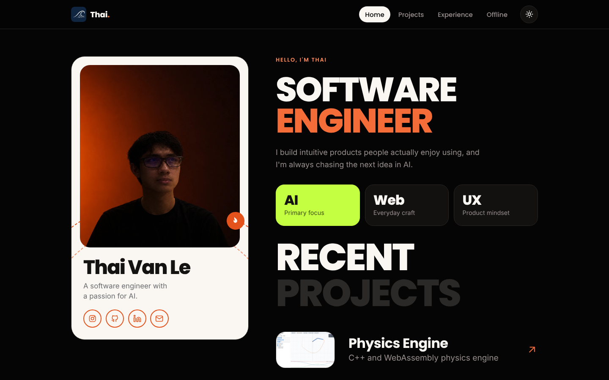

# Thai Van Le

My personal website: who I am, what I've built, and what I do outside of work.

**Live site: [thai2229.vercel.app](https://thai2229.vercel.app/)**



## Pages

- **Home:** a pinned profile card, a short intro, recent projects and work experience.
- **Projects:** Physics Engine, Tempo and Productivity App, with live demos and code links.
- **Experience:** jobs, education and skills.
- **Offline:** surfing, snowboarding and my cat, as a stack of photos that fade in as you scroll.

The site has a light and dark theme. The toggle in the header switches it with a wave that bursts out from the button. Press `t` to switch too.

## Built with

Plain HTML, CSS and JavaScript. There is no build step and no framework. It is deployed on Vercel.

## Run it locally

```bash
python3 -m http.server 8000
```

Then open http://localhost:8000.
